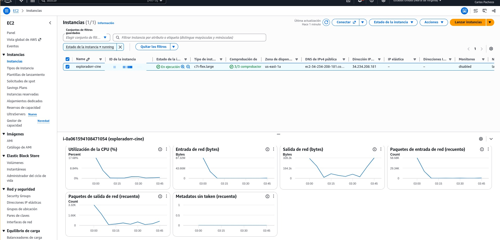

# Explorador de Cine

Aplicación web para descubrir películas y series, consultar sus detalles y guardar títulos favoritos en el navegador. Los catálogos y las imágenes se obtienen de [The Movie Database (TMDB)](https://www.themoviedb.org/).

## Funcionalidades

- Explorar tendencias semanales de películas y series.
- Buscar títulos y paginar los resultados.
- Filtrar por género los títulos de la página cargada.
- Consultar sinopsis, póster, fecha de estreno, calificación, géneros y otros datos disponibles.
- Guardar y quitar favoritos; la colección persiste en `localStorage` del navegador y se sincroniza entre pestañas.
- Mostrar estados de carga, error con opción de reintento, resultados vacíos y página 404.
- Diseño adaptable a móviles y escritorio.

## Despliegue público

La aplicación está desplegada en una instancia EC2 y se puede visitar en:

[http://ec2-34-234-208-181.compute-1.amazonaws.com/](http://ec2-34-234-208-181.compute-1.amazonaws.com/)

La siguiente captura muestra la instancia EC2 utilizada para el despliegue:



La aplicación desplegada en la página de tendencias:


## Requisitos

- Node.js compatible con Next.js 16.
- pnpm (la versión del proyecto se especifica en `package.json`).
- Token de lectura de la API de TMDB.

## Configuración local

1. Instala las dependencias desde la raíz del proyecto:

   ```bash
   pnpm install
   ```

2. Crea el archivo local de variables de entorno:

   ```bash
   cp .env.example .env.local
   ```

3. En `.env.local`, asigna tu token de lectura de TMDB a `TMDB_API_READ_ACCESS_TOKEN`. Puedes obtenerlo en la sección **Settings > API** de tu cuenta de TMDB.

   ```dotenv
   TMDB_API_READ_ACCESS_TOKEN=tu_token_de_lectura
   TMDB_API_BASE_URL=https://api.themoviedb.org/3
   ```

   El token se usa únicamente en el servidor. No lo renombres con el prefijo `NEXT_PUBLIC_` ni publiques `.env.local`.

4. Inicia el servidor de desarrollo:

   ```bash
   pnpm dev
   ```

5. Abre [http://localhost:3000](http://localhost:3000).

Sin un token válido, las solicitudes a TMDB fallarán y la aplicación mostrará un mensaje de error.

## Rutas de la aplicación

| Ruta | Descripción |
| --- | --- |
| `/` | Portada y tendencias |
| `/buscar` | Búsqueda, filtro por género y paginación |
| `/favoritos` | Colección guardada en el navegador |
| `/peliculas/[id]` | Detalle de una película |
| `/series/[id]` | Detalle de una serie |

## API interna

Los Route Handlers del servidor validan los parámetros, llaman a TMDB con el token privado y normalizan los errores antes de responder.

| Endpoint | Parámetros principales | Uso |
| --- | --- | --- |
| `GET /api/tmdb/trending` | `type` (`movie` o `tv`), `page` | Tendencias semanales |
| `GET /api/tmdb/search` | `type` (`movie` o `tv`), `query`, `page` | Búsqueda de títulos |
| `GET /api/tmdb/genres` | `type` (`movie` o `tv`) | Géneros disponibles |
| `GET /api/tmdb/details` | `type` (`movie` o `tv`), `id` | Detalle de un título |

Las páginas de detalle presentan la estructura mediante Server Components; la carga de datos, la interacción del catálogo y los favoritos usan Client Components cuando necesitan estado del navegador. La búsqueda y las vistas de catálogo emplean `useState` y `useEffect`.

## Tecnologías

- Next.js 16 con App Router
- React y TypeScript
- Tailwind CSS
- API de TMDB
- pnpm

## Comandos

| Comando | Descripción |
| --- | --- |
| `pnpm dev` | Servidor de desarrollo |
| `pnpm lint` | Análisis estático con ESLint |
| `pnpm typecheck` | Verificación de tipos con TypeScript |
| `pnpm build` | Compilación de producción |
| `pnpm start` | Servidor de producción (después de `pnpm build`) |

## Estructura principal

```text
src/
  app/
    api/tmdb/       Route Handlers de TMDB
    buscar/         Página de búsqueda
    favoritos/      Página de favoritos
    peliculas/      Detalle de películas
    series/         Detalle de series
  components/
    catalog/        Catálogo, tarjetas, paginación y estados
    detail/         Presentación de detalles
    favorites/      Estado y controles de favoritos
  lib/
    tmdb/           Cliente de servidor, cliente del navegador y tipos
```
